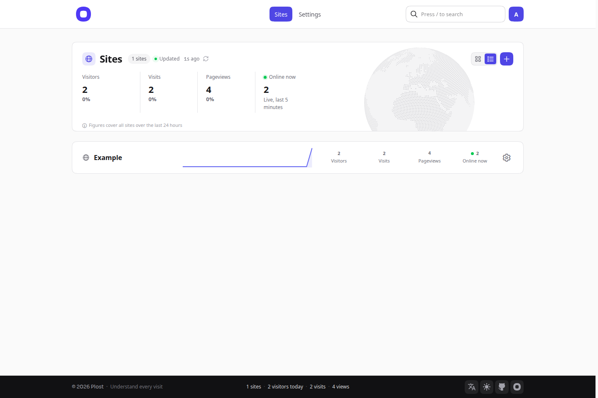
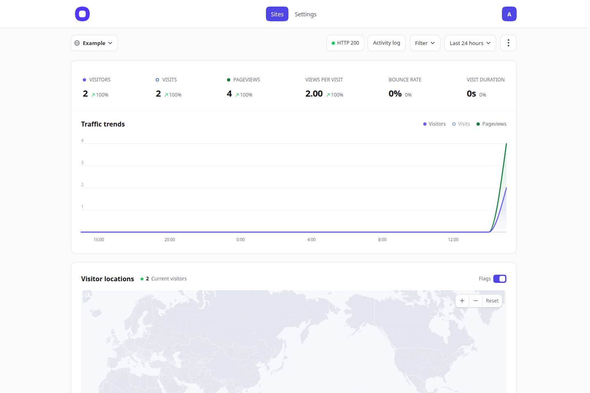

**English** · [简体中文](README.zh-CN.md)

<p align="center">
  <a href="https://plo.st"></a>
</p>

<p align="center"><b>Self-hosted website analytics in one Go binary.</b></p>

<p align="center">
  <a href="https://go.dev/"></a>
  <a href="https://www.sqlite.org/"></a>
  <a href="LICENSE"></a>
</p>

<p align="center">
  <a href="https://plo.st">Website</a> ·
  <a href="https://github.com/plost-dev/plost">Source</a> ·
  <a href="docs/guide.md">Operations guide (中文)</a>
</p>

Plost counts who visited, where they came from, and which pages they opened. It is a single static binary: the dashboard, the tracker, and a SQLite database. There is no Node process, no PostgreSQL, and no ClickHouse to run. One administrator owns the instance and can track many sites. Public signup does not exist; the first launch creates the only account.

The numbers follow the same visitor and visit rules as Umami, so the two can be compared. Raw IP addresses are not stored.

<p align="center">
  
</p>

<p align="center">
  
</p>

## Features

- **Traffic.** Visitors, visits, pageviews, pageviews per visit, bounce rate, visit duration, and who is online in the last five minutes.
- **Trend.** Visitors and pageviews on one chart (line or bar). Visits can be turned on from the legend. The choice stays in the browser.
- **Breakdowns.** Referrer sites, campaign tags, pages, countries, regions, cities, browsers, operating systems, devices, languages, and screen sizes. One filter per dimension, and they stack.
- **Live overview.** A home page for every site: the last 24 hours, a rolling update time, and a map of people online in the last five minutes.
- **Events.** Outbound clicks and file downloads are recorded by the tracker. `plost.track()` records anything else you name.
- **Site checks.** Optional HTTP checks, a 90-day uptime strip, and certificate plus domain expiry (RDAP, CNNIC WHOIS for `.cn`, then [who.ga](https://who.ga)).
- **Sharing.** A public dashboard switch, and one revocable read-only link per site. Read-only API keys for the same numbers.
- **Sign-in.** Password, authenticator two-factor with recovery codes, and passkeys.
- **Backups.** Encrypted `.plostbk` files (scrypt and AES-256-GCM), on demand or on a schedule, with optional Cloudflare R2 or S3. Restore checks the file and keeps a snapshot of the current database first.
- **Interface.** Twenty languages, light and dark, four accent colors, and a layout that works on a phone. The language button is in the footer; a signed-out browser remembers the choice, and a signed-in account stores it.

Plost does not include funnels, retention, keyword rankings, or a team of user accounts.

## Quick start

Go 1.27 or newer. The repository already contains the built web assets, so a Go toolchain is enough:

```sh
git clone https://github.com/plost-dev/plost.git
cd plost
go build -trimpath -ldflags='-s -w' -o plost ./cmd/plost
./plost -listen 127.0.0.1:3101 -data ./data
```

Open <http://127.0.0.1:3101>, create the administrator, and add a site. The password is at least 8 characters, with no character-class rules, and at most 72 bytes (the bcrypt limit). After that account exists, `/setup` is gone for good.

There are no published release binaries in this repository. [Building from source](#building-from-source) is how you get the program, including the Linux and macOS binaries from `./build.sh`.

## Installation

### A reverse proxy

Keep Plost on localhost and terminate TLS in front of it. Set `-origin` to the public URL so the session cookie is `Secure` and the host is checked.

```sh
./plost \
  -listen 127.0.0.1:3101 \
  -data /var/lib/plost \
  -origin https://stats.example.com \
  -env-file /etc/plost/plost.env
```

[`deploy/plost.service`](deploy/plost.service) is a systemd unit (user `plost`, state directory `/var/lib/plost`, env file `/etc/plost/plost.env`). [`deploy/Caddyfile`](deploy/Caddyfile) is a matching Caddy site. nginx or any other proxy works the same way: forward the site, and forward `/api/send`, `/api/event`, and `/e` unchanged so the tracker can post.

Plost does not ship a Docker image or a compose file. The binary is static (`CGO_ENABLED=0`), so it can run inside a container you write yourself. Official support is the binary plus a reverse proxy.

### Visitor IP and proxies

With no extra flags, Plost picks a visitor address the way Umami does: a single CDN header (`CF-Connecting-IP`, `True-Client-IP`, `Ali-CDN-Real-IP`, `EO-Connecting-IP`, `Fastly-Client-IP`), then the first public address in `X-Forwarded-For`, then `Forwarded`, then `X-Real-IP`, then the TCP peer. Country prefers `CF-IPCountry` or `CloudFront-Viewer-Country`.

Those headers affect only that visitor's own deduplication and country. Login and restore rate limits always use the real peer, so a forged header cannot bypass them.

`-trusted-proxies` switches to a strict reading: only listed proxies may supply the address, and `X-Forwarded-For` is walked from the right, skipping trusted hops. Values are `loopback`, `private` (LAN and Docker), `cloudflare`, a CIDR or address, or `@file` (one entry per line, `#` comments). `0.0.0.0/0` is rejected. `-client-ip-header` names a single-address CDN header, and it applies only together with `-trusted-proxies`. `-trust-proxy` is the old name for `-trusted-proxies loopback`.

## Configuration

### Flags

| Flag | Default | |
| --- | --- | --- |
| `-listen` | `127.0.0.1:3101` | HTTP listen address |
| `-data` | `./data` | Private data directory |
| `-origin` | empty | Public origin, for example `https://stats.example.com`. Sets `Secure` cookies and rejects other hosts |
| `-trusted-proxies` | empty | Proxies whose forwarding headers count. See above |
| `-trust-proxy` | `false` | Same as `-trusted-proxies loopback` |
| `-client-ip-header` | empty | Header a trusted proxy sets to the visitor address alone |
| `-geoip-db` | empty | MaxMind-format database you update yourself. Turns off the built-in download |
| `-env-file` | `$PLOST_ENV_FILE` | Env file the settings pages write. Needs to be writable by the process |
| `-allow-outbound` | empty | Extra CIDRs that site checks and cloud backups may dial, for a local proxy's fake-IP range such as `198.18.0.0/15`. Not a switch in the UI, and not `0.0.0.0/0` |
| `-memory` | `64` | Soft memory limit for the Go runtime, in MiB. Not a hard cap on the process |
| `-version` | | Print the version and exit |

### Environment

Secrets are read from the environment, not from SQLite. With `-env-file` set, the settings pages write the matching line and apply it without a restart. Leave a field blank to keep the current value.

| Variable | |
| --- | --- |
| `PLOST_ENV_FILE` | Path of the env file when `-env-file` is not passed |
| `PLOST_MAPBOX_TOKEN` | Public Mapbox token (`pk.`). A secret `sk.` token is rejected |
| `PLOST_GOOGLE_MAPS_KEY` | Google Maps JavaScript API key (`AIza`) |
| `PLOST_BACKUP_ACCESS_KEY` | R2 or S3 access key |
| `PLOST_BACKUP_SECRET_KEY` | R2 or S3 secret key |
| `PLOST_BACKUP_PASSWORD` | Password for scheduled backups, 12 to 256 bytes. No quotes, backslashes, `$`, newlines, or surrounding spaces, because systemd rewrites those |
| `UMAMI_DATABASE_URL` | Read by `plost-import-umami` only. Not a flag |

A bad value for a map key or the backup password stops the process at startup and names the variable.

### Data directory

| Path | |
| --- | --- |
| `plost.db` | SQLite database. `plost.db-wal` and `plost.db-shm` may appear beside it |
| `plost.lock` | Held while the process is running |
| `backups/` | Manual exports, scheduled copies, and the snapshot taken before a restore |
| `geoip/GeoLite2.mmdb` | City database, when Plost downloads it |

Do not commit or publish this directory. It holds accounts, sessions, and analytics.

## Add the tracker

In the site's `<head>`, once:

```html
<script defer data-domain="example.com" src="https://stats.example.com/script.js"></script>
```

The site's installation page prints the real snippet. `/js/script.js` and `/tracker.js` serve the same file. `window.plost` and `window.litestats` are the same object, and the anonymous id is stored on the measured site as `litestats:visitor-id`.

```html
<script>
  plost.track("Signup");
  plost.track("Signup", { plan: "pro" });
</script>
```

`data-outbound="false"` and `data-file-downloads="false"` turn those automatic events off. `data-api` sends the older body to a different URL.

The first pageview waits until `document.readyState` is `complete`. A browser with `navigator.webdriver` sends nothing. The server drops empty user agents and known bots, previewers, monitors, and script clients. A normal hit is a JSON `POST` to `/api/send` (`{"type":"event","payload":{...}}`), which is also what an Umami tracker posts, so those scripts can point here. If `fetch` is blocked in the browser, the same event is retried at `/e` (a 1×1 image, then Beacon). The server keeps the event id for 15 minutes and does not store the duplicate.

The tracker does not set cookies. The dashboard login does.

## How a visitor is counted

- **Visitor.** HMAC of site, IP, user agent, and UTC month. A new IP is a new visitor. The next month is a new visitor. The raw IP is not kept. If the real address is not known, the browser id is used instead, so a reverse proxy cannot collapse everyone into one person.
- **Visit.** The same visitor, continued until 30 minutes pass with no event.
- **Pageview.** Every load, including a refresh.
- **Bounce.** A visit with a single pageview.
- **Duration.** Time from the first pageview of a visit to the last. There is no heartbeat, so time on the final page is not measured.
- **Online.** Distinct visitors with an event in the last five minutes.

## HTTP API

Create a key under **Settings → API**. It looks like `plst_` plus 48 hex characters, is stored only as a hash, and is shown in full once. It can read one site.

```sh
curl --fail-with-body 'https://stats.example.com/api/v1/stats?period=summary' \
  -H "Authorization: Bearer $PLOST_TOKEN"
```

`period` is `summary` (default), `live`, `today`, or `yesterday`. Optional `domain` must be the key's site. Each credential is limited to 60 reads a minute. A share-link token is still accepted as the bearer, for keys created before API keys existed. The response keeps `apiVersion`, `site`, `period`, `generatedAt`, `onlineWindowSeconds`, and `data`.

`GET /api/v1/openapi.json` is a short OpenAPI description of that route. The longer guide is on the website: <https://plo.st/self-hosted-docs.html#api>. Signed in, `/docs/api` opens **Settings → API**; signed out, it sends you to that page.

Share links and the public dashboard are read-only reports. They cannot open the activity log, the account, backups, or site checks.

CSV export for a signed-in administrator is `GET /api/export/{domain}`.

## Backups

**Settings → Backup and restore** downloads a `.plostbk` file. The password is separate from the account password, at least 12 bytes, and is not stored next to the file. Recovery needs the account password, the backup password, and the confirmation text `RESTORE`. Plost writes a pre-restore snapshot under `backups/before-restore-*.db`, then swaps the database. Sessions are dropped; sign in with the account that was inside the backup.

Scheduled backups use the same file format, live in `backups/scheduled/`, and can be uploaded to R2 or S3 over HTTPS on a public address. Plost does not delete old objects in the bucket.

A `.lsb` file from the older PostgreSQL and ClickHouse edition cannot be restored into this SQLite database. The formats are not compatible.

## GeoIP

With no `-geoip-db`, Plost downloads GeoLite2-City from <https://ipdata.plost.io/>, checks the published SHA-256, and replaces `geoip/GeoLite2.mmdb` by rename. It looks for a new build once a day. **Settings → IP database** shows the version and an Update button.

Mainland China province and city names come from [cnip.io](https://cnip.io) (ip2region). That query sends the visitor IP to cnip.io; the same address is asked at most once a day. The settings page says so. A database download does not include visitor addresses. Events already stored are never looked up again, because the raw IP was never saved.

`-geoip-db /path/GeoLite2-City.mmdb` uses your file and never downloads. Replace it by writing a new file and renaming it over the old one.

## Import from Umami

`plost-import-umami` is a separate program so the PostgreSQL driver stays out of the server. It only reads Umami, and it only writes a Plost data directory that is not in use. `import` is a dry run until `-apply`. After writing, it compares each day and rolls the whole import back if the counts disagree.

```sh
export UMAMI_DATABASE_URL='postgres://umami@db.example.com/umami?sslmode=require'
./plost-import-umami list
./plost-import-umami import -data /var/lib/plost -site <umami-id>=example.com -create-sites -timezone Asia/Shanghai
# stop Plost, then:
./plost-import-umami import -data /var/lib/plost -site <umami-id>=example.com -apply
```

`./plost-import-umami` with no arguments prints the flags in English and Chinese. Progress lines are Chinese. The connection string is an environment variable only. Details, including what is not imported, are in [docs/guide.md](docs/guide.md).

## Building from source

The UI is React, Vite, and Tailwind, and it is compiled into the binary. You need Bun only when the interface changes. Go alone is enough to compile a checkout, because `internal/plost/web` is already built.

```sh
cd frontend
bun install --frozen-lockfile
bun run typecheck
bun run check:locales
bun run build
cd ..
CGO_ENABLED=0 go build -trimpath -ldflags='-s -w' -o plost ./cmd/plost
```

`./build.sh` cross-compiles `plost` and `plost-import-umami` for `darwin/arm64`, `linux/amd64`, and `linux/arm64` with `CGO_ENABLED=0`. Set `PLOST_REBUILD_UI=1` to rebuild the UI first.

```sh
go test ./...
go test -race ./...
go vet ./...
```

Tests create temporary SQLite files. They do not open an existing database. The Umami importer's integration test runs only when `UMAMI_TEST_DATABASE_URL` points at an empty disposable PostgreSQL.

## Tech stack

- **Server.** Go 1.27, `modernc.org/sqlite` (no cgo), `go-webauthn` for passkeys, standard-library HTTP.
- **UI.** React 19, TanStack Router, Vite, Tailwind CSS 4. The built files are embedded with `go:embed`.
- **Maps.** A built-in world map. Optional Mapbox GL or Google Maps, one at a time.
- **Storage.** One SQLite file per instance. Analytics, accounts, sessions, shares, API-key hashes, site checks, and icons live there. Map and backup secrets do not.

## Compared with Plausible and Umami

| | Plost | Umami | Plausible |
| --- | --- | --- | --- |
| Process | One Go binary | Application plus PostgreSQL | Application plus PostgreSQL and ClickHouse |
| Visitor | Hash of site, IP, user agent, and month | Same idea | Cookieless, its own model |
| Visit | 30 minutes idle | 30 minutes idle | Session model of its own |
| Accounts | One administrator, no public signup | Many users | Many users |
| Tracker | Umami-shaped `POST /api/send`, plus a retry | Umami script | Plausible script |

Plost is the small installation: one file, one database, one owner. Umami is the closer cousin for definitions and for moving history across. Plausible is a different product, with a different stack and a different way of counting.

## Language

The interface ships in twenty languages. Simplified Chinese is the source text; English and the other catalogs translate it. With nothing saved, Plost follows the browser (it reads `navigator.languages`, not an `Accept-Language` header). English browsers land on English, Chinese browsers on Chinese, and an unrecognized language on Simplified Chinese. The footer language button changes it immediately. Creating the administrator saves the language that is on screen, so the dashboard does not jump back to Chinese. Traditional Chinese is generated with OpenCC; do not edit `frontend/src/locales/zh-TW.json` by hand.

## License

[MIT](LICENSE). Copyright 2026 gentpan.

Some icons, fonts, and map previews under `frontend/public/` carry their own notices. See the `LICENSE` and `SOURCES` files next to them.
