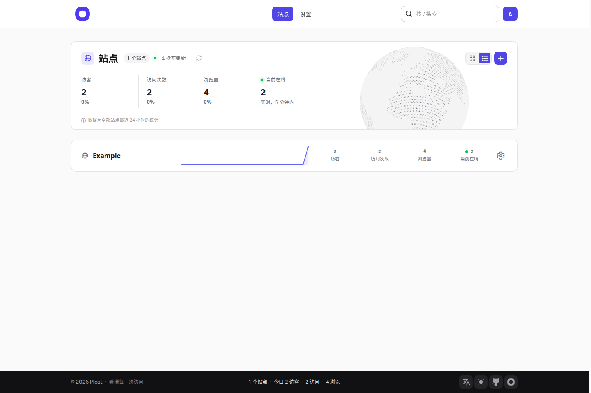
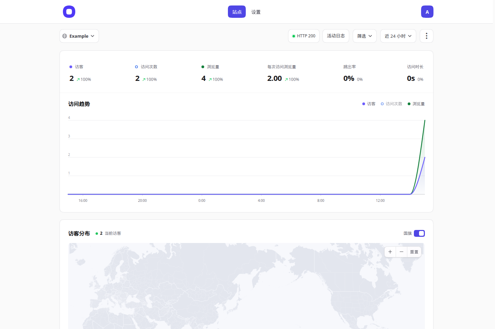

[English](README.md) · **简体中文**

<p align="center">
  <a href="https://plo.st"></a>
</p>

<p align="center"><b>好看、轻巧、只属于你的网站统计。</b></p>

<p align="center">
  <a href="https://go.dev/"></a>
  <a href="https://www.sqlite.org/"></a>
  <a href="LICENSE"></a>
</p>

<p align="center">
  <a href="https://plo.st">官网</a> ·
  <a href="https://github.com/plost-dev/plost">源码</a> ·
  <a href="docs/guide.md">使用与部署指南</a>
</p>

谁来过、从哪来、看了什么。Plost 把界面、追踪脚本和 SQLite 放在一个程序里：不用 Node，不用 PostgreSQL，也不用 ClickHouse。空实例第一次启动时创建唯一的管理员，之后公开注册关闭。一个管理员可以管多个网站。

统计口径靠近 Umami，两边的数字可以对着看。原始 IP 不保存。

<p align="center">
  
</p>

<p align="center">
  
</p>

## 功能

- **流量。** 访客、访问次数、浏览量、每次访问浏览量、跳出率、访问时长，以及近 5 分钟在线人数。
- **趋势。** 默认同时画访客和浏览量，曲线或柱形。访问次数在图例里打开，选择留在浏览器里。
- **拆分。** 来源网站、推广标记、页面、国家、地区、城市、浏览器、操作系统、设备、语言、屏幕。每一类只能选一个值，不同类可以叠在一起。
- **首页。** 全部站点近 24 小时的数字，以及近 5 分钟在线位置。
- **事件。** 脚本自己记录外链点击和文件下载。`plost.track()` 记录你自己命名的事件。
- **站点检查。** 可选的 HTTP 检查、近 90 天在线、证书和域名到期（RDAP，`.cn` 再查 CNNIC WHOIS，还没有日期才查 [who.ga](https://who.ga)）。
- **分享。** 公开仪表盘开关，以及每个站点一条可关闭的只读链接。只读 API Key 读同一组数字。
- **登录。** 密码、验证器两步验证和恢复码、Passkey。
- **备份。** 加密的 `.plostbk`（scrypt 与 AES-256-GCM），手动或定时，可选上传到 Cloudflare R2 或 S3。恢复前先留一份当前数据库。
- **界面。** 二十种语言、深色和浅色、四种强调色，手机上同样可用。语言按钮在页脚：未登录记在浏览器，登录后记在账号。

没有漏斗、留存、关键词排名，也没有多账号团队。

## 三步开始

需要 Go 1.27 或更新版本。仓库里已经带上构建好的网页，只装 Go 就能编译：

```sh
git clone https://github.com/plost-dev/plost.git
cd plost
go build -trimpath -ldflags='-s -w' -o plost ./cmd/plost
./plost -listen 127.0.0.1:3101 -data ./data
```

打开 <http://127.0.0.1:3101>，创建管理员，再添加网站。密码至少 8 个字符，不限制字符类型，最长 72 字节（bcrypt 的上限）。这个账号创建之后，`/setup` 就不再开放。

仓库不提供预编译的发布包。[从源码构建](#从源码构建)是取得程序的方式，`./build.sh` 会打出 Linux 和 macOS 的二进制。

## 安装

### 反向代理

Plost 听在本机，TLS 放在前面。`-origin` 写成对外的地址，登录 Cookie 才会带 `Secure`，并且拒绝其他 Host。

```sh
./plost \
  -listen 127.0.0.1:3101 \
  -data /var/lib/plost \
  -origin https://stats.example.com \
  -env-file /etc/plost/plost.env
```

[`deploy/plost.service`](deploy/plost.service) 是 systemd 单元（用户 `plost`，数据目录 `/var/lib/plost`，env 文件 `/etc/plost/plost.env`）。[`deploy/Caddyfile`](deploy/Caddyfile) 是对应的 Caddy 配置。nginx 或其他代理同样可用：把站点转过去，并原样转发 `/api/send`、`/api/event` 和 `/e`，追踪请求才到得了。

仓库里没有 Docker 镜像，也没有 compose 文件。二进制是静态链接（`CGO_ENABLED=0`），可以放进你自己写的容器。目前支持的方式是二进制加反向代理。

### 访客 IP 与代理

不加参数时，Plost 自己找访客地址，顺序和 Umami 一样：CDN 的单一地址头（`CF-Connecting-IP`、`True-Client-IP`、`Ali-CDN-Real-IP`、`EO-Connecting-IP`、`Fastly-Client-IP`），然后 `X-Forwarded-For` 里第一个公网地址，然后 `Forwarded`，然后 `X-Real-IP`，最后是连接方。国家优先用 `CF-IPCountry` 或 `CloudFront-Viewer-Country`。

伪造这些头只影响伪造者自己的去重和国家。登录、恢复等频率限制始终按真实连接方计算，绕不过去。

`-trusted-proxies` 改成严格规则：只相信列出的代理，`X-Forwarded-For` 从右往左读，跳过受信任的地址。可以写 `loopback`、`private`（内网和 Docker）、`cloudflare`、网段或单个地址，或 `@文件`（每行一个，`#` 后是注释）。不接受 `0.0.0.0/0`。`-client-ip-header` 指定 CDN 自己的单一地址头，必须和 `-trusted-proxies` 一起用。`-trust-proxy` 等于 `-trusted-proxies loopback`。

## 配置

### 启动参数

| 参数 | 默认 | |
| --- | --- | --- |
| `-listen` | `127.0.0.1:3101` | HTTP 监听地址 |
| `-data` | `./data` | 数据目录 |
| `-origin` | 空 | 对外地址，例如 `https://stats.example.com`。Cookie 加 `Secure`，并拒绝其他 Host |
| `-trusted-proxies` | 空 | 哪些代理的转发头算数，见上一节 |
| `-trust-proxy` | `false` | 等于 `-trusted-proxies loopback` |
| `-client-ip-header` | 空 | 受信任代理用来单独放置访客地址的头 |
| `-geoip-db` | 空 | 自己维护的 MaxMind 格式库。指定后不再下载 |
| `-env-file` | `$PLOST_ENV_FILE` | 设置页要写入的 env 文件，进程必须能写 |
| `-allow-outbound` | 空 | 站点检查和云备份额外允许连接的网段，例如本机代理的 `198.18.0.0/15`。界面里没有开关，也不能写成 `0.0.0.0/0` |
| `-memory` | `64` | Go 运行时的软内存上限，单位 MiB，不是整个进程的硬限制 |
| `-version` | | 打印版本后退出 |

### 环境变量

密钥从环境变量读取，不进 SQLite。设置了 `-env-file` 时，设置页会改写对应的一行并立即生效，不用重启。输入框留空表示保持原值。

| 变量 | |
| --- | --- |
| `PLOST_ENV_FILE` | 没有 `-env-file` 时使用的 env 文件路径 |
| `PLOST_MAPBOX_TOKEN` | Mapbox 公开 Token（`pk.`）。`sk.` 私密密钥会被拒绝 |
| `PLOST_GOOGLE_MAPS_KEY` | Google Maps JavaScript API 的 Key（`AIza`） |
| `PLOST_BACKUP_ACCESS_KEY` | R2 或 S3 的 Access Key |
| `PLOST_BACKUP_SECRET_KEY` | R2 或 S3 的 Secret Key |
| `PLOST_BACKUP_PASSWORD` | 计划备份密码，12 到 256 字节。不能含引号、反斜杠、`$`、换行或首尾空格，systemd 会改写这些字符 |
| `UMAMI_DATABASE_URL` | 只给 `plost-import-umami` 用，不是启动参数 |

地图 Key 或备份密码格式不对时，程序启动即退出，并指出是哪一项。

### 数据目录

| 路径 | |
| --- | --- |
| `plost.db` | SQLite 数据库。旁边可能有 `plost.db-wal` 和 `plost.db-shm` |
| `plost.lock` | 进程运行时占用 |
| `backups/` | 手动导出、定时备份，以及恢复前留下的快照 |
| `geoip/GeoLite2.mmdb` | Plost 自己下载的城市库 |

不要提交或公开这个目录。里面有账号、会话和统计。

## 加上追踪脚本

放进网站的 `<head>`，只放一次：

```html
<script defer data-domain="example.com" src="https://stats.example.com/script.js"></script>
```

站点的安装页会生成实际地址。`/js/script.js` 和 `/tracker.js` 是同一个文件。`window.plost` 和 `window.litestats` 是同一个对象，匿名编号存在被统计网站的 `litestats:visitor-id`。

```html
<script>
  plost.track("Signup");
  plost.track("Signup", { plan: "pro" });
</script>
```

`data-outbound="false"` 和 `data-file-downloads="false"` 关掉自动的外链和下载事件。`data-api` 把旧格式发到另一个地址。

第一次浏览要等 `document.readyState` 变成 `complete`。`navigator.webdriver` 为真的浏览器什么都不发。服务端丢掉空的浏览器标识，以及自报为爬虫、预览、监控或脚本客户端的请求。正常请求是 JSON `POST` 到 `/api/send`（`{"type":"event","payload":{...}}`），Umami 自己的脚本发来的也能收。浏览器里 `fetch` 被拒绝时，同一事件改发到 `/e`（先是 1×1 图片，再是 Beacon）。服务器按编号记住 15 分钟，重复的不再存。

追踪脚本不设置 Cookie。后台登录会设置会话 Cookie。

## 怎么计数

- **访客。** 站点、IP、浏览器标识和 UTC 月份的 HMAC。换 IP 就是新访客，换月也是。原始 IP 不留下。拿不到真实地址时改用浏览器标识，避免反代把所有人合成一个。
- **访问。** 同一访客一直活动，闲置 30 分钟后重新计。
- **浏览量。** 每次打开都算，刷新也算。
- **跳出。** 只有一个浏览量的访问。
- **访问时长。** 一次访问里第一次浏览到最后一次浏览。没有心跳，最后一页上停留的时间量不到。
- **在线。** 近 5 分钟里出现过事件的不同访客。

## HTTP API

在**设置 → API** 申请 Key。形式是 `plst_` 加 48 位十六进制，只存哈希，完整内容只显示一次。一把 Key 只读一个站点。

```sh
curl --fail-with-body 'https://stats.example.com/api/v1/stats?period=summary' \
  -H "Authorization: Bearer $PLOST_TOKEN"
```

`period` 可以是 `summary`（默认）、`live`、`today`、`yesterday`。可选的 `domain` 必须就是这把 Key 的站点。每个凭证每分钟最多 60 次。以前的分享链接凭证仍可作为 Bearer 使用。响应保留 `apiVersion`、`site`、`period`、`generatedAt`、`onlineWindowSeconds` 和 `data`。

`GET /api/v1/openapi.json` 是这条接口的简短 OpenAPI。完整说明在官网：<https://plo.st/self-hosted-docs.html#api>。登录后打开 `/docs/api` 会到**设置 → API**，未登录则转到官网文档。

分享链接和公开仪表盘只能看报表，不能看活动明细、账号、备份或站点检查。

已登录的管理员导出 CSV：`GET /api/export/{domain}`。

## 备份

**设置 → 备份与恢复**下载 `.plostbk`。备份密码和账号密码分开，至少 12 字节，不会写在文件旁边。恢复需要账号密码、备份密码，以及确认文字 `RESTORE`。Plost 先在 `backups/before-restore-*.db` 留下当前库，再换上备份。会话全部失效，用备份里的账号重新登录。

定时备份用同一格式，放在 `backups/scheduled/`，可以上传到公网 HTTPS 上的 R2 或 S3。程序不会删除桶里的旧对象。

旧版 PostgreSQL + ClickHouse 的 `.lsb` 不能恢复进这个 SQLite 库。两种格式不能混用。

## IP 数据库

没有 `-geoip-db` 时，Plost 从 <https://ipdata.plost.io/> 下载 GeoLite2-City，核对公布的 SHA-256，再改名换成 `geoip/GeoLite2.mmdb`。每天看一次有没有新版本。**设置 → IP 数据库**显示版本和「更新」按钮。

中国大陆访客的省份和城市来自 [cnip.io](https://cnip.io)（ip2region）。这次查询会把访客 IP 发给 cnip.io，同一个地址一天最多查一次。设置页写明了这一点。下载数据库本身不包含访客地址。已经存下的事件不会再补查，因为原始 IP 从未保存。

`-geoip-db /路径/GeoLite2-City.mmdb` 改用你自己的文件，程序不再下载。更新时先写好新文件，再改名覆盖，不要原地改写。

## 从 Umami 搬迁

`plost-import-umami` 是单独的程序，PostgreSQL 驱动不会进服务。它只读 Umami，只写入一个已经停掉的 Plost 数据目录。`import` 在加上 `-apply` 之前只做预演。写入之后按天对账，有一项对不上就整批撤回。

```sh
export UMAMI_DATABASE_URL='postgres://umami@db.example.com/umami?sslmode=require'
./plost-import-umami list
./plost-import-umami import -data /var/lib/plost -site <umami-id>=example.com -create-sites -timezone Asia/Shanghai
# 先停止 Plost，再：
./plost-import-umami import -data /var/lib/plost -site <umami-id>=example.com -apply
```

不带参数运行会用英文和中文打印选项。过程中的进度仍是中文。连接地址只能放在环境变量里。不搬哪些内容，写在[使用指南](docs/guide.md)里。

## 从源码构建

界面是 React、Vite 和 Tailwind，编译进二进制。只有改界面时才需要 Bun。直接编译检出的仓库只需要 Go，因为 `internal/plost/web` 已经构建过。

```sh
cd frontend
bun install --frozen-lockfile
bun run typecheck
bun run check:locales
bun run build
cd ..
CGO_ENABLED=0 go build -trimpath -ldflags='-s -w' -o plost ./cmd/plost
```

`./build.sh` 用 `CGO_ENABLED=0` 交叉编译 `plost` 和 `plost-import-umami`，目标是 `darwin/arm64`、`linux/amd64`、`linux/arm64`。先设 `PLOST_REBUILD_UI=1` 会在编译前重建界面。

```sh
go test ./...
go test -race ./...
go vet ./...
```

测试只用新建的临时 SQLite，不会打开已有数据库。Umami 导入工具的集成测试仅在 `UMAMI_TEST_DATABASE_URL` 指向一个空的一次性 PostgreSQL 时运行。

## 技术栈

- **服务。** Go 1.27，`modernc.org/sqlite`（不用 cgo），Passkey 用 `go-webauthn`，HTTP 用标准库。
- **界面。** React 19、TanStack Router、Vite、Tailwind CSS 4。构建结果用 `go:embed` 嵌进程序。
- **地图。** 内置世界地图。可以改用 Mapbox GL 或 Google 地图，最多开一个。
- **存储。** 每个实例一个 SQLite 文件。统计、账号、会话、分享、API Key 的哈希、站点检查和图标都在里面。地图和备份的密钥不在里面。

## 和 Plausible、Umami 的差别

| | Plost | Umami | Plausible |
| --- | --- | --- | --- |
| 进程 | 一个 Go 程序 | 应用加 PostgreSQL | 应用加 PostgreSQL 和 ClickHouse |
| 访客 | 站点、IP、浏览器标识和月份的哈希 | 同一思路 | 不用 Cookie，算法不同 |
| 访问 | 闲置 30 分钟 | 闲置 30 分钟 | 自己的会话算法 |
| 账号 | 一个管理员，没有公开注册 | 多个用户 | 多个用户 |
| 追踪 | 与 Umami 同形的 `POST /api/send`，失败再重发 | Umami 脚本 | Plausible 脚本 |

Plost 是小的那一种：一个文件、一个数据库、一个主人。口径和历史数据搬迁更接近 Umami。Plausible 是另一套产品和另一套计数方法。

## 界面语言

界面带二十种语言。简体中文是原文，英文和其他语言文件翻译它。什么都没保存时，按浏览器语言选择（读的是 `navigator.languages`，不看 `Accept-Language` 头）。英文浏览器进英文，中文浏览器进中文，认不出的语言用简体中文。页脚的语言按钮马上切换。创建管理员时，当时屏幕上的语言会写进账号，进入后台后不会跳回中文。繁体中文用 OpenCC 生成，不要手改 `frontend/src/locales/zh-TW.json`。

## 许可证

[MIT](LICENSE)。Copyright 2026 gentpan。

`frontend/public/` 里部分图标、字体和地图预览另有许可，见旁边的 `LICENSE` 和 `SOURCES` 文件。
